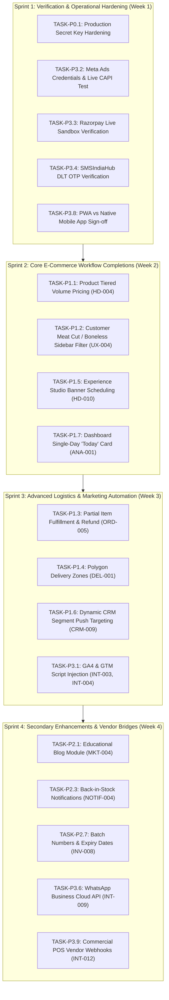

# MEATYNS — REMAINING IMPLEMENTATION ROADMAP
## Prioritized Post-Audit Engineering & Verification Roadmap

**Document Version:** 1.0.0  
**Date:** October 24, 2026  
**Auditor / Architect:** Senior Software Architect & Lead Security Auditor  
**Repository:** `Meatyns`  

---

## 1. EXECUTIVE SUMMARY & TASK PRIORITIZATION FRAMEWORK

Following the final requirement gap audit, all confirmed remaining items have been analyzed, deduplicated, and prioritized according to the following standard engineering hierarchy:

- **P0: Security, Integrity & Critical Business-Flow Safeguards** — Immediate security, data protection, or financial compliance tasks.
- **P1: Core Requirements & Incomplete Workflows** — High-impact e-commerce workflows that directly affect customer conversion or daily merchant operations.
- **P2: Remaining Requested Features** — Secondary platform enhancements, content management extensions, and automated campaign sequences.
- **P3: External Verification, Polish & Vendor Integrations** — Live credential configuration, staging verifications, third-party vendor connectors, and platform scope alignments.

---

## 2. PRIORITIZED IMPLEMENTATION ROADMAP

### P0: Security & Critical Business-Flow Safeguards (Immediate Pre-Launch)

> [!NOTE]
> All 10 previously reported codebase bugs (including the P0 Delivery OTP bypass) have been completely resolved and verified with dedicated regression tests. P0 tasks below represent operational environment safeguards required prior to opening production traffic.

#### TASK-P0.1: Production Secret Key Rotation & Environment Hardening
- **Requirement IDs:** `TECH-002`, `TECH-010`, `TECH-011`
- **Impacted Modules:** Backend environment configuration (`.env`), Auth middleware, Payment webhooks
- **Dependencies:** Production hosting setup (Render / Kubernetes)
- **Detailed Scope:**
  1. Generate cryptographically strong, 64-character hex strings for `JWT_SECRET`, `JWT_REFRESH_SECRET`, and `RAZORPAY_WEBHOOK_SECRET`.
  2. Verify that `USE_MOCK_OTP` is set to `false` and `NODE_ENV` is set to `production` in live container definitions.
  3. Ensure `CORS_ORIGIN` strictly points to production domains and blocks wildcard `*`.
- **Acceptance Criteria:**
  - Health check endpoint confirms `NODE_ENV: "production"` and mock OTP rejected.
  - Razorpay webhooks reject payloads with invalid HMAC signatures.
- **Test Strategy:** Automated verification using existing `phase0-middleware-security.test.js` and `delivery-otp-security-hardening.test.js`.

---

### P1: Core Requirements & Incomplete Workflows (Next Sprint)

#### TASK-P1.1: Product-Level Tiered Volume Pricing (Buy More, Save More)
- **Requirement ID:** `HD-004`
- **Priority:** P1 (High Business Value)
- **Impacted Modules:**
  - Database: `backend/app/models/product.js`
  - Backend Engine: `backend/app/services/finance/pricingService.js` (`hydrateOrderItems`)
  - Admin UI: `frontend/src/modules/admin/pages/ProductManagement.jsx`
  - Customer UI: `frontend/src/modules/customer/pages/ProductDetailPage.jsx`
- **Dependencies:** Flexible units engine (Phase 4)
- **Detailed Scope:**
  1. Add optional `tieredPricing: [{ minQty: Number, discountPercentage: Number, fixedUnitPrice: Number }]` to `Product.variants` and base product schema.
  2. Update `hydrateOrderItems` in `pricingService.js` to authoritatively apply quantity tier discounts based on cart item quantity.
  3. Display interactive "Buy More, Save More" savings breakdown chips on Product Detail Page.
- **Acceptance Criteria:**
  - Adding 2+ units of a product with tier discounts correctly computes discounted line subtotal on server.
  - Client tampering with line price is authoritatively overwritten by server pricing engine.
- **Test Strategy:** New Jest test suite `__tests__/tiered-pricing.test.js` validating single-item, multi-tier, and flash deal priority.

#### TASK-P1.2: Customer Facet Filtering for Meat Cuts & Boneless Attributes
- **Requirement ID:** `UX-004`
- **Priority:** P1 (Customer UX)
- **Impacted Modules:**
  - Frontend: `frontend/src/modules/customer/pages/CategoryProductsPage.jsx`, `SearchPage.jsx`
  - Backend: `backend/app/controller/productController.js`
- **Dependencies:** Meat attributes schema (Phase 1)
- **Detailed Scope:**
  1. Add facet filter pills in category browsing sidebar: Cut Type (Curry Cut, Biryani Cut, Boneless Cubes, Fillets, Minced), Bone Type (Bone-In, Boneless), Skin Type (Skinless, Skin-On).
  2. Pass filter query parameters (`cutType`, `boneType`, `skinType`) to `GET /api/products`.
- **Acceptance Criteria:**
  - Selecting "Biryani Cut" dynamically filters category product list to matching items.
- **Test Strategy:** Integration test verifying filtered product queries.

#### TASK-P1.3: Partial Item Availability & Fulfillment (Order Item Substitution)
- **Requirement ID:** `ORD-005`
- **Priority:** P1 (Merchant Operations)
- **Impacted Modules:**
  - Database: `backend/app/models/order.js`
  - Backend: `backend/app/services/orderWorkflowService.js`, `backend/app/services/finance/orderCancellationService.js`
  - Seller UI: `frontend/src/modules/seller/pages/OrderDetail.jsx`
- **Dependencies:** Atomic order placement, Financial ledger
- **Detailed Scope:**
  1. Allow merchants to mark individual order items as "Unavailable / Out of Stock" prior to packing.
  2. Automatically compute line-item refund for unavailable items, credit wallet or initiate gateway partial refund, and adjust delivery packing slip.
- **Acceptance Criteria:**
  - Rejecting 1 item of a 3-item order updates order total, triggers partial refund ledger entry, and allows remaining 2 items to dispatch.
- **Test Strategy:** Unit test in `__tests__/partial-order-fulfillment.test.js`.

#### TASK-P1.4: Polygon Delivery Zones & Locality Rate Overrides
- **Requirement IDs:** `DEL-001`, `DEL-002`, `ADM-014`
- **Priority:** P1 (Logistics)
- **Impacted Modules:**
  - Database: `backend/app/models/deliveryZone.js` *(New)*
  - Backend: `backend/app/services/deliverySlotService.js`, `backend/app/services/finance/pricingService.js`
  - Admin UI: `frontend/src/modules/admin/pages/DeliveryManagement.jsx`
- **Dependencies:** Location services, Google Maps
- **Detailed Scope:**
  1. Create `DeliveryZone` model supporting GeoJSON Polygon geometries and custom delivery surcharge rate tables.
  2. Hook zone resolution into `calculateCustomerDeliveryFee` prior to distance fallback.
  3. Integrate visual polygon drawing tool on map in `DeliveryManagement.jsx`.
- **Acceptance Criteria:**
  - Orders placed with delivery coordinates falling inside a custom polygon zone apply the zone's specific delivery rate.
- **Test Strategy:** GeoJSON polygon point-in-polygon containment unit tests.

#### TASK-P1.5: Experience Studio Banner Scheduling & Auto-Expiry
- **Requirement IDs:** `HD-010`, `MKT-008`
- **Priority:** P1 (Marketing Operations)
- **Impacted Modules:**
  - Database: `backend/app/models/experienceSection.js`
  - Backend: `backend/app/controller/experienceController.js`
  - Admin UI: `frontend/src/modules/admin/pages/ContentManager.jsx`
- **Dependencies:** Experience Studio
- **Detailed Scope:**
  1. Add `validFrom: Date` and `validTo: Date` to `ExperienceSection` banner items.
  2. Filter out expired banners in public query `GET /api/experience`.
  3. Add date-time pickers in `ContentManager.jsx` banner upload modal.
- **Acceptance Criteria:**
  - Banners scheduled with a future `validFrom` do not appear on homepage until that time.
  - Expired banners automatically disappear without manual deletion.
- **Test Strategy:** Unit test verifying time-boundary banner filtering.

#### TASK-P1.6: Dynamic CRM Segment Push Notification Targeting
- **Requirement ID:** `CRM-009`
- **Priority:** P1 (Marketing Automation)
- **Impacted Modules:**
  - Frontend: `frontend/src/modules/admin/pages/NotificationComposer.jsx`
  - Backend: `backend/app/modules/notifications/pushNotificationService.js`, `push.controller.js`
- **Dependencies:** Customer segmentation service (Phase 2)
- **Detailed Scope:**
  1. Add audience selector in NotificationComposer: "All Customers", "New (Last 30d)", "Active Buyers", "VIP Customers", "At-Risk (Inactive)".
  2. Query FCM device tokens of users matching the selected segment and dispatch batch notification.
- **Acceptance Criteria:**
  - Admin can dispatch a targeted push alert exclusively to the `VIP` customer cohort.
- **Test Strategy:** Unit test verifying segment query token resolution.

#### TASK-P1.7: Single-Day "Today" Sales & Orders Summary Card
- **Requirement ID:** `ANA-001`
- **Priority:** P1 (Executive Visibility)
- **Impacted Modules:**
  - Frontend: `frontend/src/modules/admin/pages/Dashboard.jsx`
  - Backend: `backend/app/services/admin/dashboardService.js`
- **Dependencies:** Admin dashboard service
- **Detailed Scope:**
  1. Add single-day IST date boundary aggregation in `dashboardService.js` returning `todayRevenue`, `todayOrdersCount`, and `todayDeliveredCount`.
  2. Render dedicated "Today's Performance" KPI card on main Admin Dashboard.
- **Acceptance Criteria:**
  - Dashboard displays real-time orders and revenue placed between 00:00:00 and current time IST today.
- **Test Strategy:** Unit test verifying single-day boundary date calculation.

---

### P2: Remaining Requested Features (Mid-Term Enhancements)

| Task ID | Requirement ID | Feature Name | Impacted Modules | Key Deliverables |
| :--- | :--- | :--- | :--- | :--- |
| **TASK-P2.1** | `MKT-004` | Educational Blog & Article Module | `models/blog.js`, Customer `/blog`, Admin CMS | Admin article publisher, reader view, SEO metadata |
| **TASK-P2.2** | `MKT-005` | Promotional Session Pop-Up Modal | Customer Layout, `models/popupBanner.js` | Session-based promo modal with frequency capping (once per 24h) |
| **TASK-P2.3** | `NOTIF-004` | Back-in-Stock User Waitlist | `models/stockWaitlist.js`, `ProductDetailPage.jsx` | Customer "Notify Me" button; automated push on restock |
| **TASK-P2.4** | `NOTIF-006` | Automated Inactive Win-Back Sequences | `jobs/winbackCampaignJob.js` | Scheduled worker sending promo discount to 60d inactive users |
| **TASK-P2.5** | `NOTIF-005` | Birthday & Anniversary Automated Offers | `models/customer.js`, Bull scheduler | User DOB field, automated coupon credit on customer birthday |
| **TASK-P2.6** | `ANA-008` | Delivery Fleet SLA & Duration Analytics | `dashboardService.js`, `FleetRadar.jsx` | Average order packing time, transit time, and SLA breach metrics |
| **TASK-P2.7** | `INV-008` | Batch Numbers & Expiry Date Tracking | `models/productBatch.js`, `StoreInventoryView.jsx` | Lot code tracking, slaughter date, expiration alert warnings |
| **TASK-P2.8** | `INV-007` | Spoilage & Damaged Stock Shrinkage Ledger | `models/stockHistory.js`, `AdminWallet.jsx` | Dedicated financial loss accounting for damaged inventory |
| **TASK-P2.9** | `INV-006` | Automated Daily Stock PDF/CSV Email Reports | `jobs/dailyInventoryReportJob.js` | Scheduled 06:00 IST dark-store inventory summary email |
| **TASK-P2.10** | `DEL-010` | Dynamic Weather & Peak Demand Surge Multiplier | `deliverySlotService.js`, `pricingService.js` | Real-time demand density surge pricing multiplier |
| **TASK-P2.11** | `MKT-007` | Standalone Campaign Landing Page Builder | `models/landingPage.js`, Customer `/lp/:slug` | Custom layout builder for promotional ad destinations |
| **TASK-P2.12** | `EXP-002` | Dynamic Category Attribute Schema Builder | `models/category.js` (`attributeSchema`) | Dynamic JSON custom attribute builder per category |
| **TASK-P2.13** | `EXP-004` | Storage Temperature & Shelf Life Attributes | `models/product.js`, `ProductDetailPage.jsx` | Structured `storageTemperature` and `shelfLifeDays` fields |

---

### P3: External Verification, Polish & Vendor Integrations

| Task ID | Requirement ID | Integration / Area | External Dependencies | Action Required |
| :--- | :--- | :--- | :--- | :--- |
| **TASK-P3.1** | `INT-003`, `INT-004` | Google Analytics 4 & GTM Snippets | Google Analytics 4 Measurement ID | Inject `gtag.js` script into `frontend/index.html` |
| **TASK-P3.2** | `INT-001`, `META-001..020` | Meta Marketing API Live Verification | Meta App ID, Secret, Ad Account ID | Perform live OAuth handshake and verify CAPI event dispatches |
| **TASK-P3.3** | `INT-007` | Razorpay Production Gateway Verification | Live Razorpay Key ID & Key Secret | Execute real ₹1 payment and verify webhook capture |
| **TASK-P3.4** | `INT-008` | SMSIndiaHub Live OTP & DLT Verification | TRAI DLT approved Sender ID & Template IDs | Switch `USE_MOCK_OTP=false` and test SMS delivery to physical device |
| **TASK-P3.5** | `INT-010` | Google Maps Billing & Quota Verification | Google Cloud Console project billing | Ensure Geocoding and Directions APIs are unrestricted |
| **TASK-P3.6** | `INT-009`, `ADV-006` | WhatsApp Business Cloud API Integration | Meta WhatsApp Business API account | Implement automated transactional order update messages |
| **TASK-P3.7** | `TECH-005` | MongoDB Continuous Cloud Backup Verification | MongoDB Atlas cluster admin | Confirm automated daily snapshot schedule and retention policy |
| **TASK-P3.8** | `PS-002`, `UX-014` | Native Mobile App vs. PWA Scope Sign-Off | Client executive stakeholder | Formal written decision on whether PWA fulfills scope |
| **TASK-P3.9** | `INT-012` | Retail POS / ERP Connector (Petpooja/Tally) | Client retail POS vendor contract | Configure webhook forwarding to `/api/v1/integrations/pos` |

---

## 3. EXACT RECOMMENDED IMPLEMENTATION ORDER

